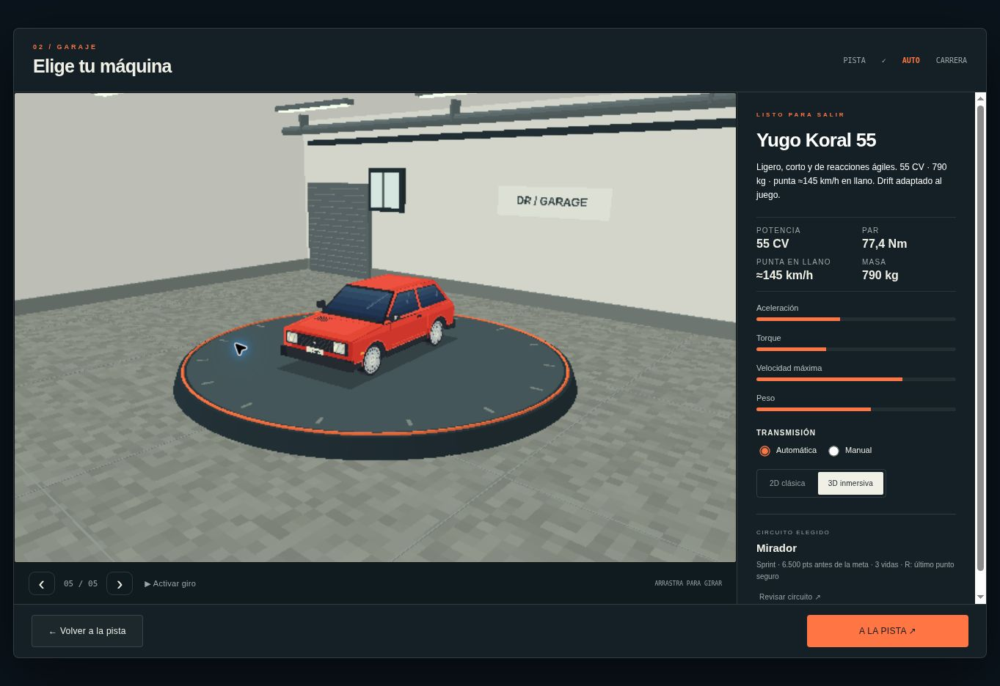
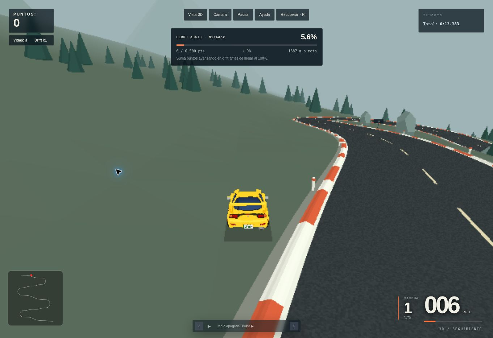
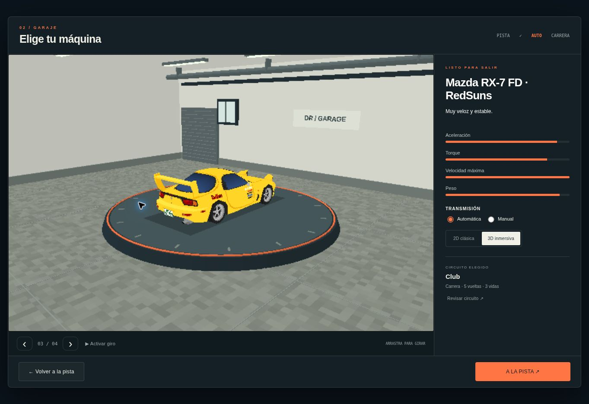
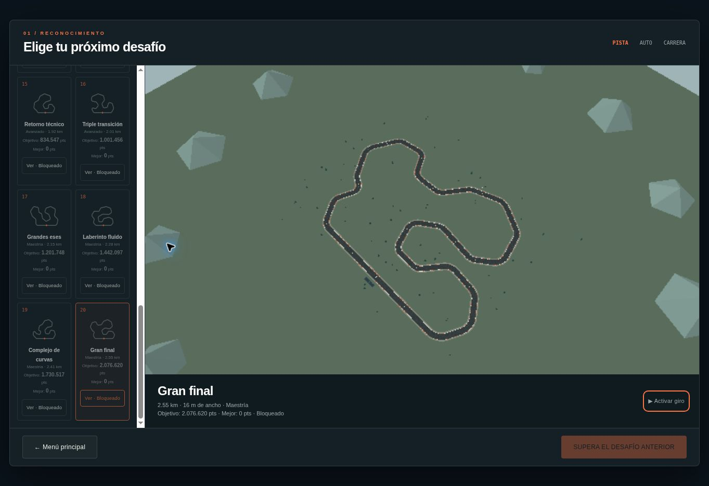
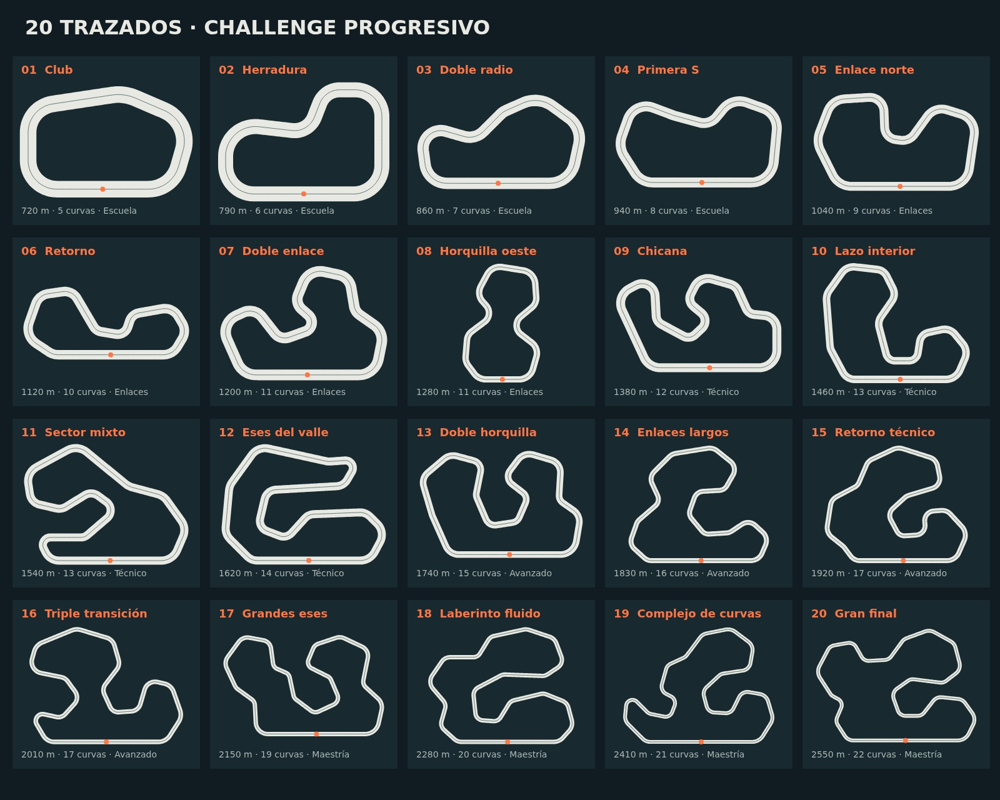
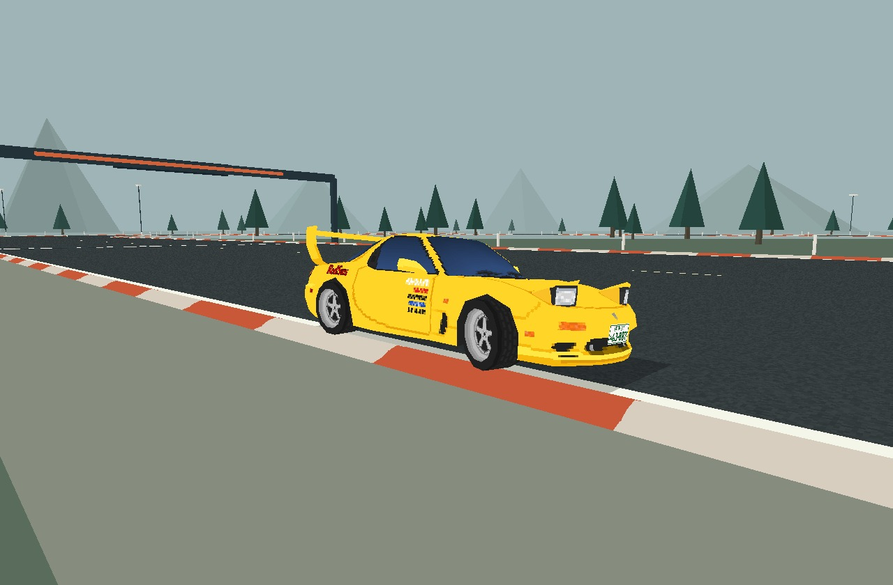

# Drift Racer 0.8.0 — 2D + 3D

Juego de drift estático para navegador, con dos vistas intercambiables de **una misma simulación**. Incluye seis autos, veinte desafíos, editor de circuitos, transmisión manual/automática y contrarreloj con fantasma local.

[Jugar en Render](https://driftgame.onrender.com)

## Jugar y ejecutar

Servir la raíz del repositorio con cualquier servidor estático, por ejemplo:

```sh
python3 -m http.server 8000
```

Abrir `http://localhost:8000`. No necesita compilación ni instalar dependencias para jugar. `index.html` es el punto de entrada; `index_*` son versiones históricas.

- **Carrera rápida:** circuito con vista aérea 3D → garaje → carrera de cinco vueltas.
- **Cerro abajo:** elegir descenso → reconocimiento 3D → garaje → sprint de 0 a 100%. Hay que alcanzar el objetivo de drift y cruzar la meta; el resultado se decide al terminar.
- **Desafíos:** vista aérea del circuito → garaje → objetivo de puntos → reconocimiento del siguiente desafío. Se pueden explorar los bloqueados, pero solo jugar los desbloqueados.
- **Contrarreloj:** elegir y previsualizar uno de los veinte circuitos → garaje → vueltas libres con el fantasma del récord.
- **Creativo:** dibujar circuito cerrado → vista aérea 3D → garaje → carrera. Los códigos `TRK` y `TRK2` siguen siendo compatibles.
- **Configuración:** vista, cámara, calidad, barra día/atardecer/noche, movimiento reducido y controles táctiles automáticos/forzados.

El garaje es el último paso: modelo 3D sobre una tarima giratoria, estadísticas originales, transmisión, vista 2D/3D y resumen del circuito. Arrastrar o usar las flechas con el visor enfocado cambia el ángulo; «Pausar giro» detiene la rotación. «Volver a la pista» conserva la selección. Los circuitos importados y enlaces compartidos también pasan por la vista aérea antes del garaje.

## Cinemática, pianos y chat (0.8.0)

- **Drift visual:** pulsar Shift o DRIFT produce una apertura suave del campo de visión (zoom leve en 2D), con ataque y regreso amortiguados. No cambia aceleración, adherencia, dirección ni suspensión. Mantener el botón no repite el impulso.
- **Líneas manga:** vectores animados en la periferia, con centro despejado y densidad menor en móvil. Configuración permite seguir el auto, fijar el centro o desactivarlas; el impulso tiene un ajuste independiente. Movimiento reducido desactiva ambos efectos.
- **Piano x5:** con el drift ya en x3, al menos una rueda debe tocar la parte elevada del piano. Se usan las cuatro posiciones de ruedas de cada modelo y el perfil físico de la pista. Al perder contacto o entrar en la transición de derrape vuelve a x3 sin borrar el combo. Colisión, salida o pérdida real del drift conservan las reglas de ruptura anteriores.
- **Dron:** disponible al conducir con C o en Configuración. Hace pasadas y arcos acotados, con altura adaptada a la ladera.
- **Repetición local:** aparece en Pausa o al terminar, después de dos segundos grabados. Montaje alterna dron, isométrica y cámaras fijas cerca de curvas; se puede elegir un plano, pausar, buscar y reproducir a 0,5× / 1× / 2×. Las cámaras fijas ceden a una toma aérea si el auto se aleja demasiado. Escape vuelve al estado previo. En online se habilita al terminar la carrera, con los tres autos.
- Se guardan hasta los últimos **10 minutos** de poses, suspensión, ruedas y caídas, a un máximo de 20 muestras/s. La memoria de los buffers está limitada a **4,56 MB para tres autos**. No se resimula la física al mirar o buscar. El humo y las marcas se reconstruyen como efectos visuales. La grabación vive en memoria y se reemplaza al iniciar otra carrera; no se exporta como video.
- **Chat de sala:** disponible en el lobby y resultados, con texto de hasta 180 caracteres, un mensaje por segundo por piloto e historial temporal de 40 mensajes. Solo se distribuye a la sala y se recupera al reconectar. Nombres/autor son asignados por el servidor; el cliente presenta texto literal. No se envía el historial en las instantáneas de carrera.

## Cerro abajo

Veinte rutas abiertas: las tres primeras rediseñadas y diecisiete nuevas. Cada alineación combina rectas, arcos amplios, contracurvas y horquillas con radios y separaciones propios. Las transiciones de curvatura son suaves; la pendiente varía dentro de cada recorrido. La ladera sigue un plano ajustado al trazado real. Se mantienen colores, árboles, barreras, pianos, autos y dinámica de conducción.

| Ruta | Sprint | Desnivel | Pendiente media | Objetivo |
| --- | --- | --- | --- | --- |
| Mirador | 1.66 km | 118 m | 6.8% | 7,000 pts |
| Quebrada | 2.15 km | 189 m | 8.5% | 9,000 pts |
| Cumbre | 2.41 km | 259 m | 10.5% | 10,500 pts |
| Las Lajas | 2.34 km | 141 m | 5.8% | 10,500 pts |
| Alto Rehue | 2.08 km | 259 m | 12.1% | 9,500 pts |
| Santa Elvira | 2.23 km | 175 m | 7.7% | 10,500 pts |
| Ramal del Litre | 2.38 km | 235 m | 9.6% | 11,500 pts |
| La Viñuela | 2.44 km | 163 m | 6.5% | 12,000 pts |
| Paso Cardenal | 2.52 km | 346 m | 13.4% | 13,000 pts |
| Los Maitenes | 2.50 km | 205 m | 8.0% | 13,000 pts |
| Cuesta Bellavista | 2.83 km | 335 m | 11.6% | 15,000 pts |
| Filo del Arrayán | 2.79 km | 422 m | 14.7% | 15,000 pts |
| Las Vertientes | 2.89 km | 211 m | 7.2% | 16,000 pts |
| Portal del Coihue | 3.15 km | 399 m | 12.4% | 18,000 pts |
| El Resguardo | 3.12 km | 289 m | 9.1% | 18,000 pts |
| Abra Lucero | 3.42 km | 550 m | 15.8% | 20,500 pts |
| La Herradura Vieja | 3.25 km | 334 m | 10.1% | 19,500 pts |
| Camino de Antul | 3.12 km | 265 m | 8.3% | 19,500 pts |
| Portezuelo Seco | 3.48 km | 515 m | 14.5% | 22,000 pts |
| Travesía del Cóndor | 4.64 km | 612 m | 13.0% | 29,500 pts |

El desnivel incluye la zona de frenado tras la meta. Las veinte rutas están disponibles. En escritorio el HUD mantiene progreso, objetivo, pendiente y distancia restante. En móvil solo aparece el porcentaje junto al tacómetro; el objetivo queda pequeño bajo los puntos. Alcanzar el puntaje no termina el sprint: hay que cruzar el 100%.

- Gravedad de 9,81 m/s² proyectada sobre la pendiente; el auto rueda sin acelerar. La masa conserva su efecto en aceleración y frenado, pero no aumenta artificialmente la aceleración gravitatoria. Los frenos mantienen el auto detenido en la pendiente.
- Contacto de cuatro ruedas con altura real, suspensión, inclinación de carrocería y transferencia longitudinal aproximada. El piso, los pianos y las alturas renderizadas proceden del mismo trazado.
- Salidas a la ladera: caída bajo gravedad, cuerpo rígido aproximado con inercia de caja y ocho puntos de contacto, impulsos, fricción y vuelcos. La cámara muestra el auto durante la caída, incluso si se conducía desde el capó.
- **R** o **Recuperar** devuelve el auto al último punto seguro y consume una de tres vidas. Después de 4,5 s de caída se recupera automáticamente. El punto seguro avanza cada 60 m estando dentro de la carretera; no se elige la curva inferior más cercana.
- La validación exige continuidad de avance sobre la carretera. Los atajos por el barranco no adelantan el sprint; volver sobre un tramo ya recorrido no permite repetir sus puntos. Los trazados revisados usan récords `downhill:v2:*`, separados de Challenge y TT. Los registros anteriores se conservan almacenados y no se comparan con carreteras distintas.
- Ambos modos visuales usan la misma simulación. 2D conserva su vista cenital; 3D muestra el relieve y el vuelco. Las físicas de los circuitos anteriores permanecen intactas.

Es una física jugable aproximada, no un simulador de neumáticos/deformación. Referencias técnicas: [componentes de gravedad en una pendiente, OpenStax](https://openstax.org/books/physics/pages/5-4-inclined-planes), [fricción y fuerza normal, OpenStax](https://openstax.org/books/university-physics-volume-1/pages/6-2-friction) y [modelo de masa apoyada por rueda, Unity](https://docs.unity3d.com/es/530/ScriptReference/WheelCollider-sprungMass.html). El código es propio y no utiliza Unity.

## Continuidad de drift y móvil (0.7.0)

- El combo acumula puntos a través de x1 → x2 → x3. Un cambio de dirección o la interrupción visual de las marcas de neumáticos no lo reinicia.
- Hasta 0,45 s de transición sin deslizamiento conservan la cadena, sin generar puntos durante ese intervalo. Una histéresis de entrada/salida evita oscilaciones cerca del umbral. Salirse, detenerse, circular hacia atrás/en sentido contrario, colisionar o perder el derrape durante más tiempo corta puntos activos y multiplicador juntos. El total de la sesión conserva sus reglas anteriores.
- Caída, recuperación y rechazo de avance no pueden restaurar un combo perdido. El control físico de motor, dirección, frenos, transmisión y efectos de neumáticos se compara con el fixture original.
- Mantener **DRIFT** táctil activa también el acelerador, sin otra etiqueta ni pulsación. El freno tiene prioridad sobre esa asistencia; soltar/cancelar un dedo no suelta el otro pedal. Teclado: W/acelerador, Shift/drift, Espacio/freno, E/Q/cambios, sin asistencia añadida.
- Anuncio de combo al 46% de la escala de escritorio en pantallas compactas; porcentaje de descenso junto al velocímetro, tanto vertical como horizontal.

## Optimización de montañas (0.7.0)

Las miniaturas reutilizan alineaciones ligeras y no construyen índices de colisión. El muestreo calcula raíz y ángulo solo para el segmento ganador. El recorte del terreno usa primero el contorno local de cada baldosa; se comparten vértices y se conserva el sombreado plano por triángulo. No se simplifican caras, alturas, bordillos ni colisiones. Las señales reutilizan una textura y los límites de visibilidad del escenario estático se calculan una sola vez.

Comparación de los mismos cuatro trazados, calidad alta, buffers de atributos e índices de geometrías únicas (excluye texturas y matrices de instancias):

| Ruta | Antes | Después | Reducción | Triángulos, sin cambios |
| --- | ---: | ---: | ---: | ---: |
| Mirador | 6,460,420 B | 2,819,560 B | 56.4% | 95,556 |
| Cumbre | 7,332,768 B | 3,385,278 B | 53.8% | 109,693 |
| Filo del Arrayán | 8,236,844 B | 3,853,652 B | 53.2% | 124,462 |
| Travesía del Cóndor | 16,833,344 B | 6,706,352 B | 60.2% | 225,672 |

Reproducir métricas actuales: `node scripts/benchmark-descent.mjs`. Pasar niveles separados por comas para otros recorridos. Estas cifras miden memoria de geometría, no una mejora equivalente de FPS ni del tamaño de descarga. Los 17 descensos nuevos se describen en código; no añaden modelos ni texturas descargables.

Validación: `npm run test:core` (77 pruebas), incluidas las veinte geometrías, diferencias de silueta y pendiente, terreno sin caras sobre el asfalto en cinco rutas representativas, continuidad del combo, pedales táctiles, recuperación, suspensión y regresión online. Revisión de interfaz en 390×844, 844×390 y escritorio. El navegador de revisión utiliza render compatible; falta medir FPS en teléfonos físicos con WebGL.

## Yugo Koral 55

Quinto auto, sin reemplazar los cuatro anteriores. Carrocería retopologizada a partir de las proporciones del modelo de 3DDomino y las tres fotos aportadas: hatchback de tres puertas, capó corto, techo alto, portón inclinado, faros rectangulares, defensas oscuras y llantas de acero. La técnica visual reproduce la de los modelos de Fujiwara y RX-7 suministrados: atlas de 512×512, material sin iluminación PBR y filtro de vecino más cercano. Los píxeles del Yugo son nuevos; no se reutilizan adhesivos ni texturas del AE86.

- GLB de 84.904 bytes, 764 triángulos y cinco mallas: carrocería + cuatro ruedas. Largo 3,49 m, altura 1,335 m y batalla 2,15 m; pivotes y huellas ajustados a su trocha de 1,308 m. Las ruedas delanteras dirigen, todas giran y reciben suspensión independiente.
- Ficha de referencia: Koral 1.1 carburado, 55 CV, 77,4 Nm, 790 kg, 145 km/h y 0–100 km/h en 18 s. [Ficha técnica de Koral, copia archivada](https://es.scribd.com/doc/45284408/Yugo-Koral-tehn-karakt).
- Prueba de 180 s sobre recta plana: 144,999 km/h de equilibrio y 0–100 en 18,0 s, tanto con cambios automáticos como manuales realizados en los mismos umbrales. Cinco marchas. La punta resulta del equilibrio entre propulsión y resistencia; en bajada la gravedad puede aumentarla.
- Sigue siendo una adaptación al modelo de drift del juego. No simula diferencial, neumáticos ni tracción delantera de forma completa; esos resultados no equivalen a reproducir al 100% un vehículo real.
- Se conserva la clase `Car` y el ajuste de los autos anteriores. `js/yugo-physics.js` configura exclusivamente la nueva opción; `js/yugo-model.js` conecta la malla al mismo movimiento y suspensión. Caídas y recuperación de Cerro abajo usan sus dimensiones y masa.



## Rendimiento, cielo y Fujiwara (0.5)

Las entradas y módulos JavaScript usan una versión de URL común para evitar mezclar archivos de distintas publicaciones en la caché CDN.

- El terreno de Cerro abajo se recorta contra el contorno exacto de las bermas: no existen triángulos del cerro cruzando el asfalto. Carretera, líneas, bordillos y bermas son franjas contiguas. La cámara de reconocimiento ajusta el plano cercano a la distancia del circuito para mejorar la precisión de profundidad.
- Geometría estática agrupada por material y zona de 128 m; vegetación instanciada por zona. Se ocultan sectores completos solo después de la niebla opaca: 290 m en Ligera y 440 m en Alta/Automática. Al reconocer la pista se muestra el escenario completo. No se descarga la física ni se alteran puntos de apoyo.
- Medición reproducible de los escenarios de montaña sin farolas: Mirador 2.039 → 419 mallas; Quebrada 2.594 → 505; Cumbre 3.198 → 601 (81% menos en Cumbre). En la salida de Cumbre, 113 de esos sectores están dentro de la distancia de dibujo ligera, antes del descarte por encuadre. Son contadores de escena, **no una promesa de FPS**. La triangulación precisa del borde aumenta ligeramente los triángulos totales, pero evita solapamientos y reduce llamadas de dibujo.
- Alturas de huellas persistentes calculadas una sola vez; terreno lejano omite búsquedas de carretera que no pueden influir en la altura. Resolución automática entre 0,65× y 1,5× según el tiempo de cuadro, con ajustes graduales cada tres segundos; simulación siempre a 60 Hz. Vistas previas limitadas a 30 FPS (12 en modo compatible); una vista detenida no se redibuja hasta cambiar. La escena de carrera se congela al pausar o terminar; el fondo del menú se limita a 30 FPS (10 en compatible).
- Barra día/atardecer/noche en Configuración y en la selección de descenso/circuito. Preferencia guardada. Cielo degradado, luz ambiental y niebla coordinados. Farolas con halos y manchas de luz suaves adaptadas al suelo, que se desvanecen con la distancia. Faros de todos los autos con haces transparentes, luz sobre el pavimento y una sola luz dinámica sin sombras; sin bloom ni postprocesado. La iluminación no afecta la simulación.
- Toyota AE86 Fujiwara como sexto auto: GLB suministrado de 145.452 bytes, 1.349 triángulos agrupados en carrocería y cuatro ruedas, atlas original y sprite 2D. Los pivotes, suspensión, humo y marcas de neumáticos corresponden al modelo. Ajuste jugable usando la física existente; no se presenta como simulación exacta de la ficha de un AE86 real.
- 59 pruebas de regresión y revisión visual en navegador con render compatible. El navegador de revisión no ofrece WebGL: quedan pendientes mediciones de FPS en GPU real y teléfono físico.

Referencias de implementación: [agrupación de geometría](https://threejs.org/manual/en/optimize-lots-of-objects.html), [niebla](https://threejs.org/manual/en/fog.html), [instancias](https://threejs.org/docs/#api/en/objects/InstancedMesh) de Three.js. Se usa la versión local r170 del proyecto.

## Controles

| Acción | Tecla |
| --- | --- |
| Acelerar / frenar | W o ↑ / Espacio, S o ↓ |
| Girar | A / D o flechas izquierda / derecha |
| Derrape / freno de mano | Shift |
| Subir / bajar marcha manual | E / Q (Control también baja) |
| **Alternar 2D / 3D** | **V** o botón Vista |
| **Cámara 3D: seguimiento / aérea / capó** | **C** o botón Cámara |
| Zoom de vista | Rueda del mouse |
| Pausar / reanudar o volver de un menú | Esc |
| Volver a la pista | R (cuesta una vida en individual; último control en online) |
| Reintentar al terminar | R |
| Mostrar / ocultar fantasma | G |
| Ayuda | H |

La ayuda pausa la conducción. Cambiar de pestaña o perder foco también pausa y libera las entradas. En móvil hay dirección, acelerador, freno, freno de mano y marchas manuales. La radio es opcional y solo se reproduce por una acción explícita.

## Una física, dos representaciones

`Car`, el paso fijo de 1/60 s, las reglas de puntuación, los cambios, las penalizaciones de salida y las puertas de vueltas se conservan. La vista 3D lee `player`, `track` y el fantasma; no integra otra física ni reinicia carreras al cambiar de vista. La escena genera el asfalto a partir de los mismos puntos y ancho del circuito, incluidas las pistas dibujadas/importadas.

- `js/downhill.js`: rutas abiertas, campo de alturas y física exclusiva de Cerro abajo.
- `js/mountain-scene.js`: relieve, carretera abierta, vegetación, barreras y salida/meta del sprint.
- `js/circuit-layouts.js`: veinte trazados originales con rectas, arcos tangentes, horquillas y enlaces; progresión de 720 a 2550 m en cinco etapas. El generador usa recetas de sectores y muestreo por distancia, sin ondulaciones radiales.
- `js/road-contact.js`: perfil redondeado del borde (14 cm × 70 cm) y respuesta vertical por rueda, calculada con el mismo paso fijo en 2D y 3D. Agrega altura, inclinación y amortiguación; no altera dirección, tracción, frenado ni puntuación.
- `js/view3d.js`: Three.js r170, modelos de los seis autos, ruedas orientables, humo, huellas, cámaras y entorno. La decoración no añade colisiones a las reglas originales.
- `js/rx7-model.js`: adaptación del RX-7 FD RedSuns suministrado para el auto amarillo; conserva cuatro ruedas independientes, texturas y movimiento del juego. Créditos y procedencia en `assets/models/README.md`.
- `js/track-surface.js`: une el área del circuito antes de triangular. Asfalto, línea de borde, piano y escapatoria son regiones contiguas sin superposición. El piano se eleva con seis bandas unidas y conserva sus franjas naranjas/blancas; utiliza el mismo campo de alturas que las ruedas. Se divide en sectores para descartar geometría fuera de cámara. No modifica puntos, ancho ni muestreo de físicas.
- `js/software-renderer.js`: proyección 3D con búfer de profundidad sobre Canvas para equipos sin WebGL. Reduce resolución y detalle; es más lenta que WebGL y se recomienda 2D si no resulta fluida.
- `js/menu-preview.js`: garaje original inspirado en la referencia del usuario y vista aérea del circuito real; una sola instancia de previsualización, encuadre según el trazado y render detenido cuando el menú está oculto.
- `js/experience.js`: navegación, configuración, preferencias y HUD.
- `css/experience.css`: interfaz adaptable y estilo visual.
- `vendor/`: Three.js (MIT) y Clipper 6.4.2 (Boost Software License 1.0, con aviso del subconjunto JSBN) distribuidos localmente. El juego no depende de una CDN para el 3D.

Las geometrías, materiales y texturas de la pista anterior se liberan al cambiar de circuito. La calidad limita la resolución y la cantidad de árboles. El auto amarillo usa el GLB aportado, el Yugo usa su adaptación low poly y los otros tres mantienen sus modelos geométricos. Se conserva el balanceo visual original y se suma una suspensión vertical amortiguada al cruzar el piano. Las ruedas siguen el relieve de forma independiente; la carrocería responde al apoyo de los cuatro neumáticos. Los circuitos planos no añaden paredes ni bloqueos laterales; Cerro abajo sí incorpora tramos de guardarraíl.

## Datos guardados

Se mantienen las claves `tt:*` y `challenge:*` y el formato de los fantasmas existentes. Las preferencias nuevas usan `drift:preferences:v3`. Los nuevos trazados tienen IDs distintos: los récords y fantasmas anteriores permanecen guardados, pero no se mezclan con los de rutas diferentes. Se conservan los desafíos desbloqueados y los mejores puntos históricos. Los datos pertenecen al navegador y dominio actuales: mantener `driftgame.onrender.com` evita cambiar ese origen. Borrar datos del sitio elimina el progreso.

## Pruebas

Node.js 20.19+ (recomendado 22+). Las pruebas de simulación y render de compatibilidad no necesitan dependencias:

```sh
npm run test:core
```

Comprueban la equivalencia de una conducción de 900 pasos con cambios repetidos de vista, igualdad de la clase `Car` con 0.2, cuatro ajustes de auto, veinte circuitos, vueltas, pausa/configuración, estados finales, vidas, persistencia, fantasmas, importación y comportamiento ante fallo 3D. También construyen y renderizan la escena real con los cuatro autos y tres cámaras, comprobando que no modifica la simulación.

Suite de navegador existente (requiere Playwright y Chromium):

```sh
npm ci
npx playwright install chromium
npm test
```

Usar `CHROMIUM_EXECUTABLE=/ruta/a/chromium` para un Chromium instalado. La suite bloquea servicios externos y controla el RAF cuando necesita pasos deterministas.

### Validación de esta entrega

0.4.0: 51 pruebas de núcleo aprobadas, con rutas abiertas y elevación continua, aceleración por gravedad, frenado según masa, caída/vuelco, reaparición segura, prevención de atajos, meta con/sin puntaje, pausa y equivalencia 2D/3D. Render real de los tres descensos y cámaras de seguimiento/capó/aérea/caída; las escenas no alteran la simulación. Se verifica además la punta y aceleración del Yugo, pivotes, suspensión, humo/huellas, cargas tardías, garaje, reintento y recuperación automática. Revisión de menú, garaje, HUD y descenso en navegador con render compatible. GPU real y conducción manual en teléfono pendientes. Los objetivos iniciales quedan sujetos a ajuste de dificultad tras partidas humanas completas.



0.3.4: 35 pruebas de núcleo aprobadas. Se comprueban pista → garaje → carrera, regreso al origen, bloqueo de desafíos, conservación del circuito y aislamiento respecto de la simulación. Render real de los veinte circuitos con diferentes proporciones y ángulos de cámara, cuatro autos y RX-7 con apoyo de neumáticos sobre la tarima. Inspección del flujo en navegador de escritorio con render compatible: vista aérea, selección del RX-7, giro manual/pausa, transmisión manual, inicio de carrera y pausa. El navegador de revisión no dispone de WebGL; siguen pendientes GPU real, revisión móvil de esta versión y la suite Playwright completa.




0.3.3: 28 pruebas de núcleo, con inspección de las veinte siluetas y render real de compatibilidad del RX-7 apoyado en el piano. Comprueba separación de tramos, ausencia de cruces y solapes, radios internos, continuidad de meta, progresión, identidad entre puntos del juego y miniaturas, superficies elevadas, contacto independiente, amortiguación, cruces rápidos/marcha atrás, pausa y reinicio. `Car` continúa idéntica a 0.2; la nueva respuesta vertical vive fuera de esa clase. La vista 2D sigue siendo cenital y plana, pero calcula el mismo contacto. WebGL en GPU real y una prueba de conducción manual en teléfono siguen pendientes.

Referencias de forma y criterios: [guía oficial de Tsukuba](https://www.tsukuba-circuit.jp/guide/course-spec.html) (rectas, eses y radios compuestos), [cursos de Ebisu](https://www.ebisu-circuit.com/course.html) y [plano del North Course](https://www.ebisu-circuit.com/c-images/kita.pdf), además de las referencias visuales del usuario. Son trazados originales para el juego; no réplicas ni circuitos homologados. El resalto continuo adopta la sección redondeada de la referencia aportada, con los materiales existentes.




0.3.2: pruebas del GLB real, escala y orientación, cuatro pivotes, dirección y rodadura, balanceo sin desplazar ruedas, clonación de recursos, carga tardía/fallida y máscaras/orientación de textura en el render compatible. Revisión visual frontal, lateral, trasera y superior con ese renderer. WebGL en GPU real sigue pendiente.

0.3.1: regresión geométrica de las veinte pistas, horquillas, cruces y puntos duplicados. Comprueba área cubierta, ausencia de intersecciones entre materiales, orientación de triángulos y conservación exacta del muestreo físico. El navegador de revisión no respondió durante esta corrección; se validó el render de compatibilidad fuera del navegador. La revisión WebGL en GPU sigue pendiente.

Validación anterior (0.3.0):

Pruebas de núcleo y geometría ejecutadas. Revisión de interfaz en navegador: menús, garaje, carrera, intercambio 2D/3D, pausa y tamaños de 390×844 y 844×390. El navegador de revisión no dispone de WebGL: la inspección 3D se realizó con el render de compatibilidad. Falta medir rendimiento y revisar el acabado WebGL en una GPU real y el multitáctil en un teléfono físico; la suite Playwright completa no se ejecutó en este entorno.

## Render

Sitio estático, directorio público `.` y sin paso de compilación. Mantener el servicio y dominio existentes. Publicar también `js/`, `css/`, `vendor/` y `assets/`; los `.js` deben servirse como JavaScript y no redirigirse a HTML.

## Online beta (0.6.0)

En el menú, abre **Online beta**. Escribe tu nombre y crea una sala, o entra con el código de 6 caracteres de un amigo. El anfitrión elige uno de los 20 circuitos, 1–5 vueltas y el ambiente. Cada piloto elige su auto en el garage y marca **Estoy listo**. Con 2 o 3 pilotos listos, el anfitrión inicia la salida sincronizada.

Las carreras son sin contacto. Se conserva la física de los seis autos y el cambio de vista 2D/3D. Shift activa la función de derrape que antes estaba en Espacio; Espacio frena. E/Q cambian marchas manuales. R vuelve al último control validado. Abrir el menú online no detiene la carrera. El servidor valida las vueltas y muestra la clasificación; al terminar, el anfitrión puede preparar otra carrera.

La conexión usa WebSocket seguro, predicción local e interpolación de los dos rivales. Si se interrumpe, la plaza se conserva 20 segundos. Las salas beta viven en memoria y se pierden al reiniciar el servidor. En el plan gratuito de Render, la primera conexión puede tardar mientras despierta. Ver [operación y protocolo](server/README.md).
