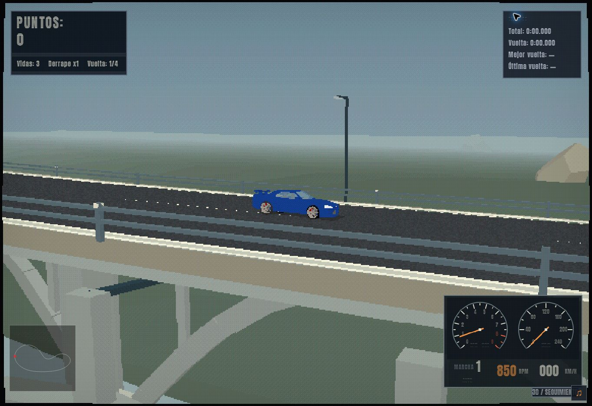
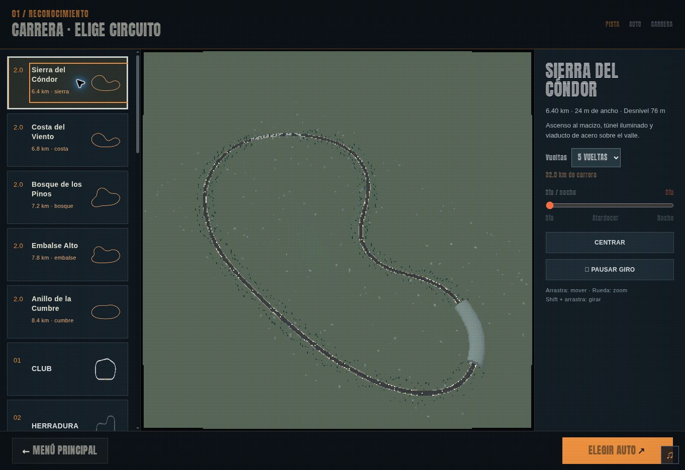

> Documento histórico de los cinco Circuitos 2.0. Siguen disponibles en el grupo de clásicos. La entrega actual de 20 carreteras está descrita en [roads-release.md](roads-release.md).

# Circuitos 2.0 — prealpha.16

Cinco trazados cerrados originales, creados para carreras largas por paisajes de montaña, costa y bosque. Se seleccionan en Carrera rápida o Contrarreloj, antes de los veinte circuitos existentes. Carrera permite cuatro o cinco vueltas; el selector muestra la distancia total. Volver desde el garaje o reiniciar conserva ruta y vueltas.

| Circuito | Vuelta | Desnivel | Pendiente máxima central | Peralte máximo | Túneles | Viaducto |
| --- | ---: | ---: | ---: | ---: | --- | --- |
| Sierra del Cóndor | 6,4 km | 76 m | 4,54 % | 6° | 416 m | 416 m, celosía de acero |
| Costa del Viento | 6,8 km | 58 m | 3,26 % | 5° | 340 + 372 m | 408 m, arcos |
| Bosque de los Pinos | 7,2 km | 92 m | 4,89 % | 6° | 540 m | 468 m, celosía de acero |
| Embalse Alto | 7,8 km | 108 m | 5,30 % | 7° | 624 m | 624 m, arcos |
| Anillo de la Cumbre | 8,4 km | 68 m | 3,10 % | 9° | 672 m | 588 m, celosía de acero |

Los datos se calculan a partir de la geometría. La pendiente es porcentaje de subida longitudinal; el peralte es inclinación transversal en grados. Todas las calzadas miden 24 m de ancho. Las carreras completas recorren entre 25,6 y 42 km. Los radios mínimos medidos son de 203 a 492 m, favoreciendo curvas largas en lugar de horquillas. La longitud mínima es más de 2,5 veces la del mayor circuito anterior (2,55 km); se entrega la medida exacta en vez de asumir que todas las pistas anteriores tenían igual longitud.

## Referencias de diseño

- [Gran Turismo: Deep Forest Raceway](https://www.gran-turismo.com/sg/gt7/events/oes2023/race_structure/) publica 4.253 m de longitud y 50 m de desnivel. Se tomó como referencia de escala, cambios de altura y secuencia de ambientes, no como trazado para copiar.
- [IndyCar: puesta a punto para Indianapolis](https://www.indycar.com/News/2023/05/05-19-Setup-Indy) distingue sus rectas planas del peralte de 9°12′ en las curvas. El Anillo usa un máximo de 9°, con transiciones suaves. No se trasladan al juego las inclinaciones mucho mayores de otros óvalos.
- Las imágenes de Gran Turismo 2 y Need for Speed High Stakes aportadas por el usuario orientan el ritmo visual: carretera abierta, portal de túnel, bosque, viaducto y horizonte natural. No se importaron sus modelos, texturas ni mapas.
- La construcción usa [BufferGeometry](https://threejs.org/docs/pages/BufferGeometry.html) e [InstancedMesh](https://threejs.org/docs/pages/InstancedMesh.html) de Three.js, con los sistemas existentes de agrupación y descarte espacial del juego.

## Superficie y conducción

`js/touring-circuits.js` define una spline cúbica periódica C2 y la remuestrea cada 4 m. La elevación es periódica, y los peraltes se suavizan sobre aproximadamente 120 m. El cierre de la vuelta mantiene continuidad de altura, pendiente y dirección.

La muestra de carretera es la autoridad común de dibujo y contacto. Su altura incluye elevación central, peralte y perfil del borde. Las ruedas se apoyan por separado, la carrocería adopta cabeceo y balanceo, y la suspensión compensa el cambio de cota sin introducir retraso vertical en una subida rápida. La gravedad se proyecta sobre pendiente y peralte. Frenar a baja velocidad mantiene el coche detenido en la cuesta.

Las barreras consideran la anchura, longitud y orientación del vehículo. Túneles y puentes conservan un corredor de conducción protegido; el coche no puede atravesar el borde del tablero. Se mantiene el modelo de conducción del juego con apoyo sobre superficie, no una simulación libre de saltos 3D. Esta decisión evita lanzamientos involuntarios al coronar las pendientes suaves solicitadas.

La IA planifica frenada según la pendiente y usa dirección ajustada para estos radios. Las pistas anteriores mantienen sus parámetros. Los récords nuevos se identifican como `TOURING.v1.<id>`; no se mezclan con tiempos de pistas planas. El formato compartido TRK, que solo representa el plano, no se ofrece para exportar estos circuitos. No se añaden al multijugador ni a la campaña existente en esta entrega.

## Estructuras y escena

Los túneles incluyen bóveda segmentada, envolvente rocosa, collar de entrada, contrafuertes, aletas de contención, nervios, conducciones, luminarias y paneles de servicio. La cámara exterior pasa a seguimiento dentro del gálibo sin cambiar la preferencia guardada. Se atenúa el sol, se activan faros y se suprime lluvia bajo cubierta.

Los viaductos tienen tablero, vigas longitudinales, travesaños, cabezales, pilares y zapatas. Las variantes de acero añaden cordones superiores e inferiores, montantes y diagonales; las de hormigón añaden arcos y soportes verticales. Las piezas estructurales quedan fuera del corredor de los autos.

El terreno se recorta alrededor de la carretera. Pintura y asfalto ocupan bandas adyacentes para evitar superficies coplanares. Vegetación y herrajes usan instancias; carretera y túneles se dividen en tramos para aprovechar el descarte espacial. Se reutilizan los niveles de calidad, la niebla y el ajuste de resolución existentes.

## Capturas de revisión

Estas capturas corresponden al renderizador compatible del entorno de pruebas, con calidad ligera. La vista de puente se encuadró mediante una página local de revisión; esa herramienta no se incluye en el juego.

## Validación

- `npm run test:core`: 214 pruebas aprobadas, incluyendo geometría, conducción, menús, cámaras, efectos y regresiones anteriores.
- `npm run test:touring`: pruebas específicas de longitud, radios, separación de corredores, continuidad, gravedad, frenos, barreras, contacto a 200 km/h, vueltas y escena.
- Simulación adicional de una vuelta completa en las 25 combinaciones de cinco autos y cinco pistas, sin salidas ni contactos con barreras en condiciones secas y sin tráfico. No equivale a una garantía de conducción perfecta con tráfico, lluvia o intervención del jugador.
- Raycasts verifican coincidencia entre el asfalto visible y el apoyo físico, ausencia de terreno atravesando la calzada y más de 5,5 m de espacio libre en el corredor probado de túneles/puentes. El error máximo observado de superficie fue inferior a 7 mm.
- Revisión visual en navegador: selector, portal, interior del túnel, puente, desnivel y flujo al garaje. El entorno disponible no tiene WebGL; la revisión usa el renderizador compatible. No se atribuyen cifras de FPS a GPU ni a dispositivos físicos.
- El comando general `npm test` incluye diez pruebas antiguas de Playwright que requieren un ejecutable de navegador ausente en este entorno. La revisión del navegador se realizó mediante la superficie de control disponible, sin alterar esas pruebas.

Antes de publicar en producción, revisar conducción y rendimiento con WebGL en escritorio y en un teléfono real. Las pruebas automatizadas acotan los problemas geométricos y físicos; no certifican ausencia absoluta de fallos en todos los equipos.
